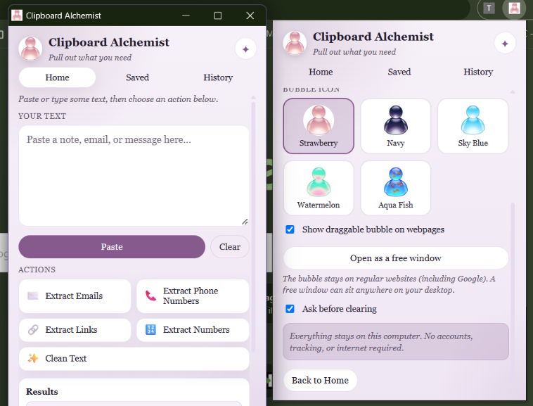
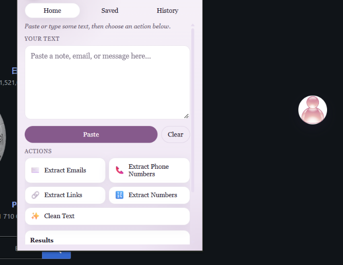
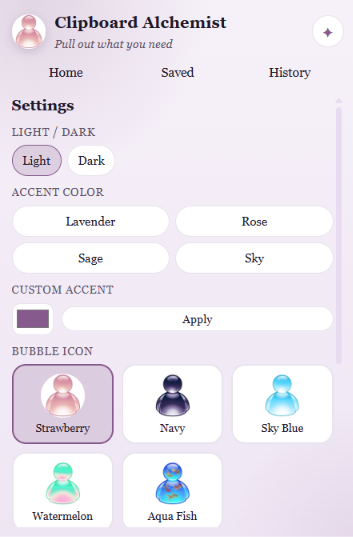
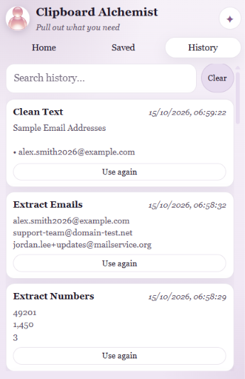
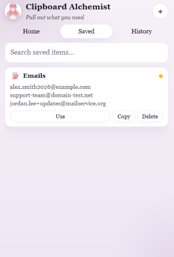

# Clipboard Alchemist

A friendly, local-first Chrome extension (Manifest V3) that helps everyday people pull emails, phone numbers, links, and numbers out of messy text — or tidy it up — entirely on your device.

No accounts. No tracking. No internet required.

## What it does

Five simple actions on the Home tab:

| Action | What you get |
|--------|----------------|
| **Extract Emails** | Unique email addresses |
| **Extract Phone Numbers** | Possible phone matches (not verified) |
| **Extract Links** | Unique web links |
| **Extract Numbers** | Standalone numbers (skips digits inside phones/dates when possible) |
| **Clean Text** | Tidier spacing and line breaks |

Also included:

- **Paste / Copy Results / Clear** with gentle clipboard permission messages
- **Saved** items with name, color, emoji, and search
- **History** of actions you run inside the extension (never silent clipboard watching)
- Right-click → **Process with Clipboard Alchemist** on selected page text
- Soft lavender look, **Light / Dark** mode, accent colors, stickers in Settings
- Serif typography (Palatino / Book Antiqua / Georgia)
- **Draggable bubble** on regular websites (position remembered across tabs)
- **Five glossy icon choices** (Strawberry, Navy, Sky Blue, Watermelon, Aqua Fish)
- **Open as a free window** — a real desktop window you can park anywhere

## Screenshots

### Home and settings



### Draggable bubble



### Settings



### History



### Saved items



### Can the toolbar popup itself stay on every tab?

No — Chrome closes the toolbar popup when you leave it. The closest reliable options (both included) are:

1. **Draggable bubble** on `http`/`https` pages (including Google) — drag to move, click to open the tools; spot is saved
2. **Free window** — Settings → “Open as a free window”

The bubble cannot appear on `chrome://` pages, the Chrome Web Store, or some built-in Chrome screens.

## Privacy

- Everything runs locally in the popup / service worker
- Saved items, history, and preferences use `chrome.storage.local` only
- Nothing is saved unless you run an action or press Save
- No clipboard polling in the background

## Permissions

| Permission | Why |
|------------|-----|
| `storage` | Save items, history, and settings locally |
| `contextMenus` | Right-click “Process with Clipboard Alchemist” |
| `clipboardRead` | Paste button |
| `clipboardWrite` | Copy Results button |

## Load unpacked

1. Open Chrome → `chrome://extensions`
2. Enable **Developer mode**
3. Click **Load unpacked**
4. Choose this folder
5. Pin the extension

Reload the extension after updates (`chrome://extensions` → refresh icon).

## Quick test

1. Paste a note with an email, a phone-like number, a link, a date, and an amount
2. Try each of the five actions — results appear below; duplicates are removed
3. Confirm phone results say **possible** / **not verified**
4. Confirm Extract Numbers keeps amounts but skips the phone/date digits when it can
5. **Copy Results**, then **Save**
6. Open **Saved** and **History**
7. Settings → switch **Light / Dark**, change accent and mascot

## Chrome limitation

Opening the popup automatically from the context menu isn’t reliable on every Chrome version. If it doesn’t open, a badge `!` appears — click the extension icon and your selected text still loads.

## File structure

```
clipboard-alchemist/
├── manifest.json
├── background.js
├── popup.html / popup.css / popup.js
├── js/detect.js | transforms.js | storage.js
├── icons/
└── README.md
```

## License

MIT — free to use, fork, and publish.
